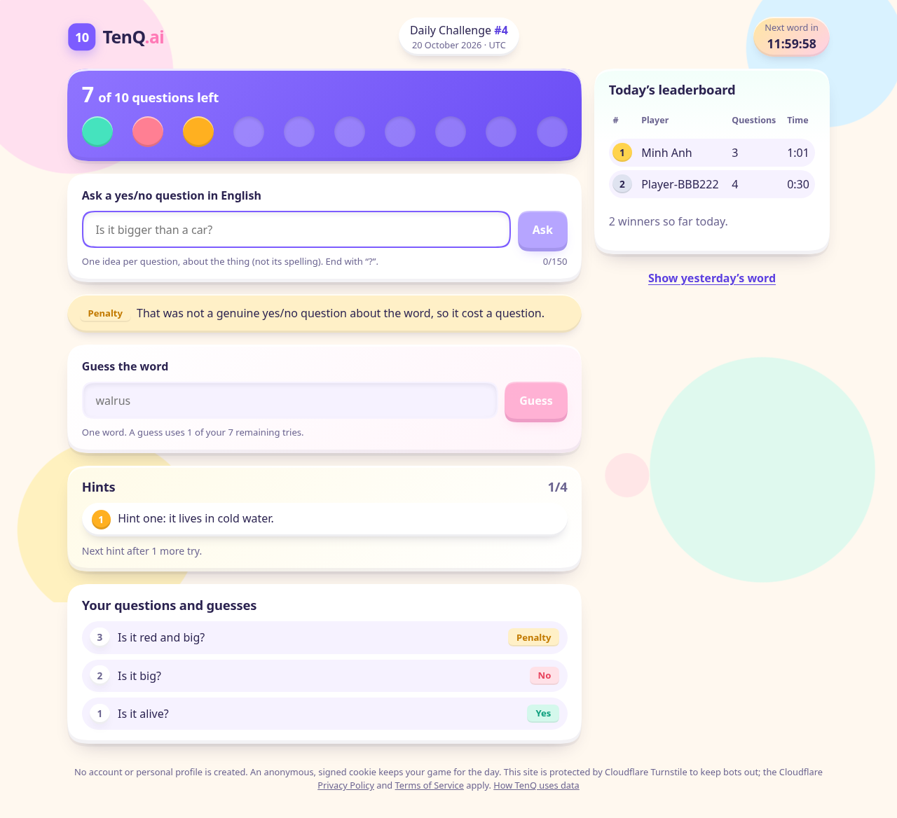
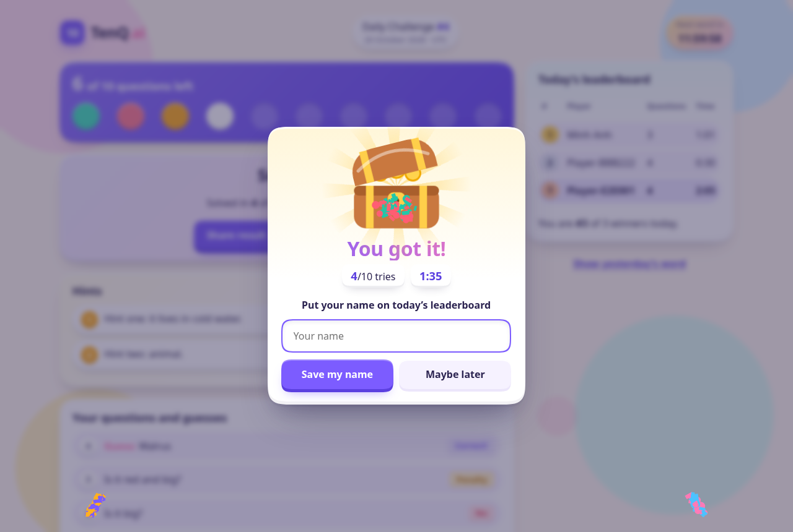
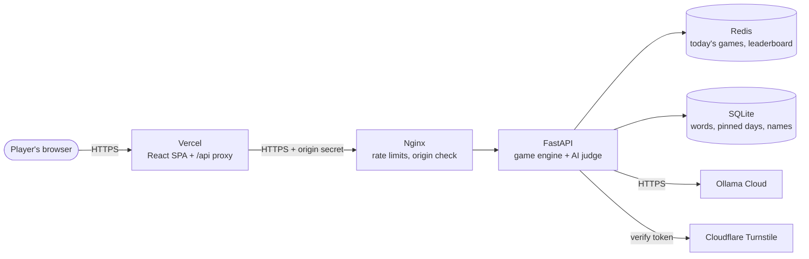

<div align="center">

# TenQ.ai

**One secret word a day. Ten yes/no questions. An AI judge.**

A zero-login daily deduction game: everyone gets the same hidden word each UTC day, asks up to
10 questions, and races up the leaderboard.

[](https://github.com/DOANHONGBAO/TenQ/actions/workflows/ci.yml)


**Play:** [ten-q.vercel.app](https://ten-q.vercel.app)



</div>

## How to play

1. Ask an English yes/no question about today's word, like *"Is it alive?"*. The AI judge answers **YES**, **NO**, **IRRELEVANT**, or **PENALTY**.
2. Every 2 tries unlock a **hint**, from vague to obvious (4 in total).
3. Think you know it? Type it in the **guess box**. A guess also costs one of your 10 tries.
4. Win with fewer questions and less time to rank higher. Winners open a treasure chest and can put their name on the leaderboard.

Fair-play rules, enforced by the server: one property per question (*"Is it red and big?"* is a penalty), no questions about spelling, letters, or length, and no prompt tricks.

<div align="center">

</div>

## Features

| | |
|---|---|
| 🗓️ **Same word for everyone** | A keyed yearly schedule picks the word for each UTC day and pins it in SQLite, so restarts never change it. |
| 🤖 **Hybrid AI judge** | Deterministic rules first (guesses, penalties, prompt injection), then Ollama Cloud with a strict one-label JSON contract, a shared daily cache, budgets, and a circuit breaker. |
| 🔟 **Exactly 10 tries** | Atomic Redis Lua scripts with idempotency keys: double clicks, retries, and parallel requests can never charge twice or exceed 10. |
| 🕵️ **Zero login** | Anonymous signed HttpOnly cookie, Cloudflare Turnstile (invisible), rate limits per player and per network. No personal data stored. |
| 🏆 **Leaderboard** | Fewer questions first, then faster time. Winners may choose a public name (validated server-side). |
| 🎨 **Playful UI** | Flat 2.0 bubbles with squircle corners and clay depth, animations that respect *reduced motion*, accessible on keyboard and screen readers. |

## Architecture



The backend stack (Nginx, API, Redis) runs with Docker Compose. Only Nginx publishes a port, and it refuses requests that did not come through Vercel. Details: [docs/architecture.md](docs/architecture.md).

## Tech stack

| Layer | Tools |
|-------|-------|
| Frontend | React, TypeScript, Vite, Vitest, Testing Library, Playwright |
| Backend | Python 3.12, FastAPI, Pydantic, uv, pytest, Ruff |
| Data | Redis 7.2 (AOF), SQLite (WAL) |
| AI | Ollama Cloud (any chat model; mock provider for development) |
| Security | Cloudflare Turnstile, signed cookies, origin secret, gitleaks, pip-audit, npm audit |
| Infrastructure | Docker Compose, Nginx, GitHub Actions, Vercel, Tailscale Funnel (temporary), Oracle Cloud Always Free (planned) |

Everything runs on free tiers and open-source software.

## Quick start

You need Git, [uv](https://docs.astral.sh/uv/), Node.js 22.12+, and Podman or Docker. On Fedora: `sudo dnf install git uv nodejs podman`.

### Play locally (backend + frontend)

```bash
# 1. Redis for the app (and a second one for the tests)
podman run -d --name tenq-redis -p 127.0.0.1:6379:6379 docker.io/library/redis:7.2-alpine
podman run -d --name tenq-redis-test -p 127.0.0.1:6390:6379 docker.io/library/redis:7.2-alpine \
  redis-server --save "" --appendonly no

# 2. Backend on http://127.0.0.1:8000
cd backend
uv sync
cp .env.example .env    # then fill the three keys, each from: python3 -c "import secrets; print(secrets.token_hex(32))"
uv run python -m app.scripts.seed_words --dev
uv run uvicorn app.main:create_app --factory --reload

# 3. Frontend on http://localhost:5173 (new terminal)
cd frontend
npm ci
npm run dev
```

The default judge is a built-in mock: no network, no key, no cost. After a reboot: `podman start tenq-redis tenq-redis-test`.

### Run the full stack in containers

```bash
infra/scripts/gen-env.sh                  # random local secrets in infra/env/*.env
podman-compose up -d --build              # or: docker compose up -d --build
podman-compose run --rm -T api python -m app.scripts.seed_words - < backend/secrets/words.json
infra/scripts/smoke.sh                    # end-to-end checks through nginx on :8080
```

<details>
<summary><b>Use the real AI judge (Ollama Cloud)</b></summary>

1. Create an API key at ollama.com and put it in `backend/.env` as `TENQ_OLLAMA_API_KEY=...` (never commit it).
2. List the models your key can use: `uv run python -m app.scripts.check_ollama_models` (add `--probe <model>` to test one).
3. Set `TENQ_AI_JUDGE=ollama` and `TENQ_OLLAMA_MODEL=<model>`. For thinking models such as `gpt-oss`, also set `TENQ_OLLAMA_THINK=low`.
4. Optional, uses quota: `uv run python -m app.scripts.evaluate_judge --live --max-requests 30` and `TENQ_LIVE_AI=1 uv run pytest -m live_ai`.

`TENQ_AI_HOURLY_BUDGET` and `TENQ_AI_DAILY_BUDGET` cap AI calls. When a budget runs out or the provider is down, players see a polite "try again" and are not charged.
</details>

<details>
<summary><b>Word list and hints</b></summary>

The real word list lives in `backend/secrets/words.json` (git-ignored, never published). Each entry has a word, metadata for the judge, and 4 hints from vague to obvious.

```bash
uv run python -m app.scripts.prepare_hints secrets/words.json   # fill missing hints (keeps yours)
uv run python -m app.scripts.seed_words secrets/words.json      # load into SQLite
```

Editing hints never changes which word belongs to which day. Keep an offline backup of the list and of `TENQ_WORD_SELECTION_KEY`.
</details>

## Testing

```bash
# backend/
uv run ruff check . && uv run ruff format --check .
uv run pytest                     # Redis tests need tenq-redis-test on :6390

# frontend/
npm run lint                      # ESLint, zero warnings
npm test                          # Vitest component and unit tests
npm run test:e2e                  # Playwright, desktop + mobile (npx playwright install chromium once)
npm run build                     # tsc type check + production build

# repository root
infra/scripts/integration.sh      # container integration test
```

CI runs all of this on every pull request, plus dependency audits, secret scanning, and an arm64 image build. See [docs/ci-cd.md](docs/ci-cd.md).

## Deployment

| Target | Status | Guide |
|--------|--------|-------|
| Vercel (frontend) + Tailscale Funnel to the owner's computer (backend) | Live, temporary | [docs/home-hosting.md](docs/home-hosting.md) |
| Vercel + Oracle Cloud Always Free VM | Prepared, not deployed | [docs/deployment.md](docs/deployment.md) |

Day-to-day on the home host: `infra/scripts/home-host.sh up` after a reboot or a `git pull`, and `home-host.sh down` to stop (data is kept). Operations, backups, and rollback: [runbook](docs/operations-runbook.md), [rollback](docs/rollback.md).

## Project structure

```
backend/
  app/
    api/            HTTP routes and dependencies (sessions, rate limits)
    core/           settings, errors, logging, security middleware
    models/         pure game rules: questions, judge rules, hints, names, schedule
    services/       use cases: game, daily word, AI judge, sessions
    repositories/   Redis (Lua scripts) and SQLite (migrations)
    integrations/   Ollama client, prompt, Turnstile, mock provider
    scripts/        seed words, prepare hints, evaluate the judge
  tests/            pytest suite
frontend/
  src/
    api/            typed API client with response validation
    state/          reducer, provider, hooks (the server is the source of truth)
    features/       game, leaderboard, celebration, session
  e2e/              Playwright tests with a fake backend
infra/              nginx templates, Redis config, env examples, scripts
deploy/             Oracle VM deploy, rollback, backup, systemd units
docs/               requirements, architecture, API contract, ADRs, runbooks
```

## Documentation

| Read this | For |
|-----------|-----|
| [docs/requirements.md](docs/requirements.md) | Game rules and product decisions |
| [docs/architecture.md](docs/architecture.md) | How the parts fit together |
| [docs/api-contract.md](docs/api-contract.md) | Every endpoint, schema, and error code |
| [docs/data-model.md](docs/data-model.md) | Redis keys and SQLite tables |
| [docs/security-threat-model.md](docs/security-threat-model.md) | Threats and mitigations |
| [docs/decisions/](docs/decisions/) | Architecture decision records |
| [docs/frontend.md](docs/frontend.md) | Components, state flow, visual design, accessibility |
| [docs/progress.md](docs/progress.md) | What changed and when |
| [CLAUDE.md](CLAUDE.md) | Working rules for AI-assisted development |

## Configuration and secrets

Backend settings are `TENQ_*` environment variables (see [backend/.env.example](backend/.env.example) and [infra/env/](infra/env/)). Frontend `VITE_*` variables end up in the public bundle and never hold secrets. Real `.env` files, the word list, and the database are git-ignored and must never be committed.
