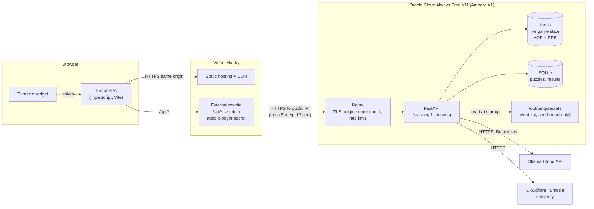
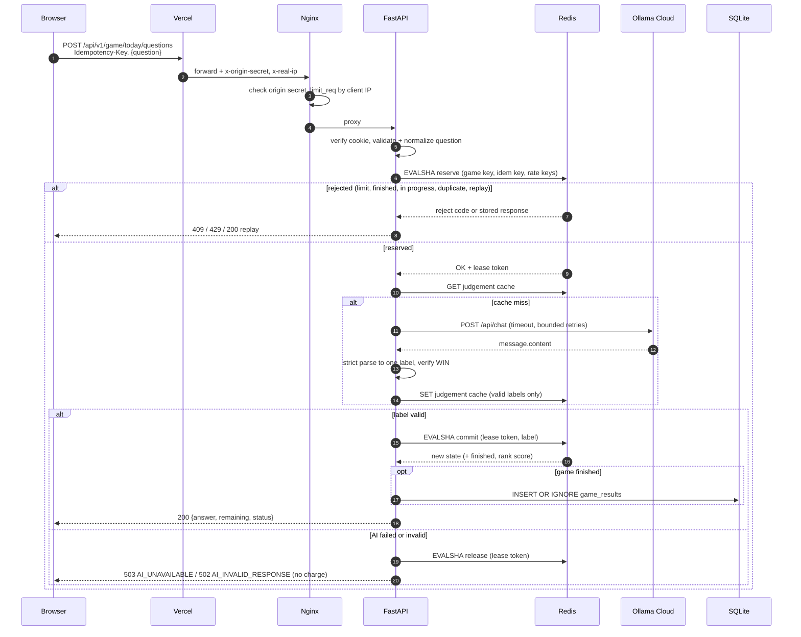
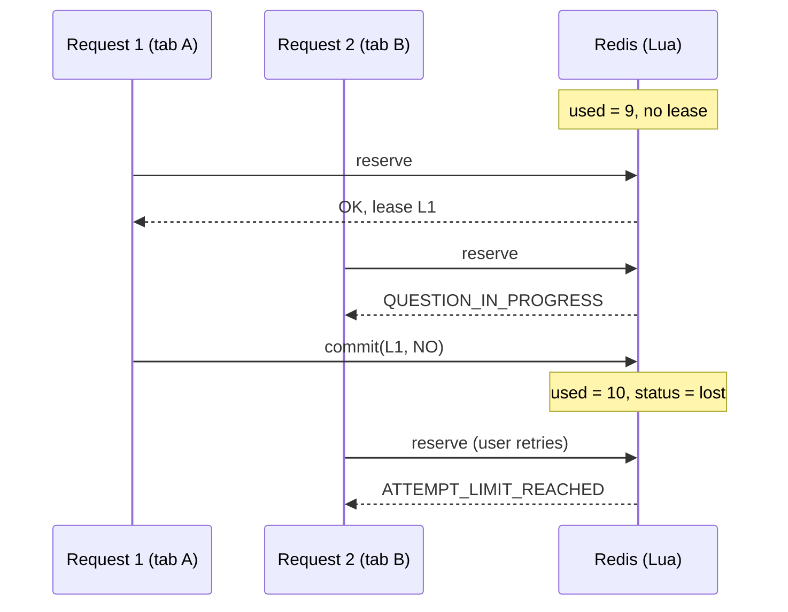
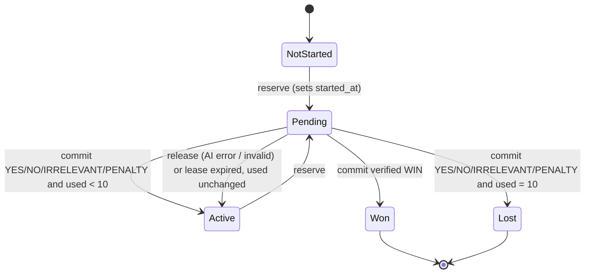
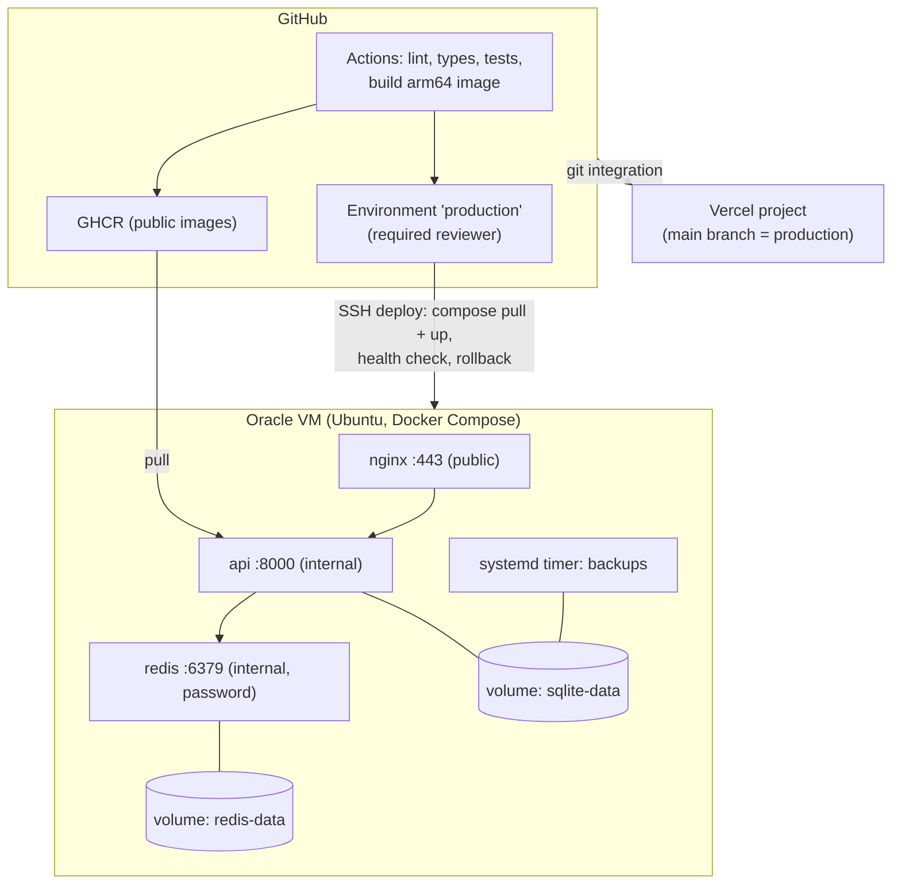

# Architecture

- Status: Proposed in Phase 01 (2026-10-17). Requirements: [requirements.md](requirements.md). Decisions: [decisions/](decisions/README.md).

## 1. Goals and constraints

- Enforce the game rules (BR-01 to BR-12) on the server; the browser is untrusted.
- Free tiers only (NFR-02): Vercel Hobby, Oracle Cloud Always Free, Ollama Cloud free plan, Cloudflare Turnstile free.
- One small VM, one API process. Scale only when measurements require it.

## 2. System overview

The browser only ever talks to the Vercel origin. Vercel forwards `/api/*` to the Oracle VM, so cookies are first-party and no CORS is needed ([ADR 0007](decisions/0007-vercel-proxy-to-oracle-origin.md)).

## 3. Responsibilities

| Concern | Frontend (React) | Backend (FastAPI) |
|---------|------------------|-------------------|
| Game rules, attempt counting, win detection | Display only | **Authoritative** |
| Question validation | UX hints (length, `?`) | Authoritative checks (OQ-04) |
| Identity | Sends cookie automatically | Issues and verifies signed cookie |
| Bot protection | Renders Turnstile, sends token | Verifies token with siteverify |
| Idempotency | Generates one `Idempotency-Key` per submission, reuses it on retry | Stores and replays results |
| Time | Countdown from server `next_reset_at` and server clock offset | Single source of time (UTC) |
| Secret word | Never receives it before the day ends | Holds it in memory and SQLite only |
| Leaderboard | Render | Compute and store |

## 4. Core flows

### 4.1 Session creation

1. SPA calls `GET /api/v1/game/today`. Without a valid cookie the API answers `401 SESSION_REQUIRED`.
2. SPA renders Turnstile, then sends `POST /api/v1/session` with the token.
3. API verifies the token with Cloudflare siteverify, applies the per-IP session creation limit, creates a random 128-bit player id, and sets the signed cookie.

Turnstile is required once per session, not once per question. This keeps gameplay smooth while making mass session creation expensive.

### 4.2 Asking a question

### 4.3 AI judge lifecycle

1. **Normalize**: trim, collapse whitespace, lower-case for comparison and hashing; the original text is kept for display.
2. **Cache lookup**: key = SHA-256 of `game_date | normalized question | prompt_version | model`. The cache is global per day, so every player gets the same answer to the same question (fairness) and repeated questions cost no quota.
3. **Budget and concurrency**: a global daily AI call budget (Redis counter) and an in-process concurrency limit (asyncio semaphore, default 4) protect the free quota. Exceeding either returns `AI_UNAVAILABLE` without charging.
4. **Call**: `POST https://ollama.com/api/chat`, `Authorization: Bearer $OLLAMA_API_KEY`, `stream: false`, temperature 0, minimal output length. Connect timeout 3 s, read timeout 12 s, total deadline 20 s. Retries: at most 2, only on timeout, HTTP 429 (honoring `Retry-After` within the deadline), and 5xx, with jittered exponential backoff.
5. **Parse**: Ollama Cloud structured outputs are not relied on ([ADR 0010](decisions/0010-ai-judge-output-contract.md)). The prompt requires a single label. The parser accepts content matching `^\W*(YES|NO|IRRELEVANT|PENALTY|WIN)\W*$` (case-insensitive) and nothing else. One stricter re-ask is allowed within the deadline if parsing fails.
6. **Verify WIN**: accepted only if the secret word (or its simple plural) appears as a whole token in the normalized question. Otherwise the result is invalid.
7. **Result**: a valid label is committed; anything else is released without charge (BR-09).

The player only ever receives a label, never model free text. A prompt injection can therefore at worst change a label, and the label `WIN` cannot be forged because of step 6.

### 4.4 Game day and the secret word

- `game_date` = current UTC date, computed by one function from an injectable clock. One word per `game_date` for all players (BR-02).
- Selection is deterministic and keyed ([ADR 0012](decisions/0012-yearly-keyed-word-schedule.md)): each calendar year has a secret permutation of the 365 words derived with HMAC-SHA256 from `TENQ_WORD_SELECTION_KEY`; day-of-year `d` uses position `d - 1`. Leap day 366 reuses an early-year word chosen by the key (at least 183 days apart), and 1 January never repeats 31 December. Code lives in `backend/app/models/word_schedule.py` (pure) and `backend/app/services/daily_word_service.py`.
- On first use each day the chosen word is pinned in SQLite (`INSERT OR IGNORE` on the date primary key). Later changes to the word list never alter a day that has started.
- The curated vocabulary (365 words with part of speech, category, definition, attributes) is a private JSON file seeded into the SQLite `words` table with `python -m app.scripts.seed_words`. The file and key live outside the repository (`backend/secrets/` locally, git-ignored; `/opt/tenq/secrets/` on the VM). The repository only generates obviously fake `zzdev...` words for development and tests.

### 4.5 Anonymous identity

- Player id: random 128-bit value from `secrets.token_bytes`, base64url-encoded.
- Cookie `tenq_sid`: value `<player_id>.<issued_at>.<HMAC-SHA256 signature>`, flags `HttpOnly; Secure; SameSite=Lax; Path=/api; Max-Age=31536000`. Signing keys support rotation (current plus previous key).
- Client IP is used only for rate limiting, as `HMAC(ip_salt, ip)` with a salt that changes every UTC day. Raw IPs are never stored or logged by the application.
- Leaderboard and results store `player_hash = HMAC(player_hash_key, player_id)`, never the raw id.

## 5. Concurrency design

Requirement: two simultaneous requests from one player must never exceed 10 consumed questions, and one submission must never be charged twice (NFR-03).

Design ([ADR 0003](decisions/0003-atomic-game-state-redis-lua.md)): all state transitions are Redis Lua scripts, which Redis executes atomically. A question goes through **reserve, then commit or release**:

| Script | Atomic checks and effects |
|--------|---------------------------|
| `reserve` | Idempotency key: replay stored response, or reject if pending or body hash differs. Game must be `active` (create it with `started_at` if absent). `used < 10`. No unexpired lease (one in-flight question per player). Normalized question not already asked. Then: set lease token and `lease_until`, record idempotency key as pending. |
| `commit` | Lease token must match. `used += 1` (also for `WIN`, BR-08), append history, cache response under the idempotency key. If `WIN`: status `won`, `finished_at`, leaderboard `ZADD NX`. Else if `used == 10`: status `lost`. Clear lease. |
| `release` | Lease token must match. Clear lease and delete the pending idempotency record so the client may retry with the same key. Nothing is charged. |

Why this is safe:

- The check `used < 10` and the lease acquisition happen in the same atomic step, and only one lease can exist, so a second concurrent request gets `409 QUESTION_IN_PROGRESS` before any AI call.
- The AI call happens outside Redis, so a slow provider never blocks other players.
- If the API process crashes mid-call, the lease expires (`lease_until` = now + 30 s, longer than the 20 s AI deadline) and the next `reserve` treats it as released. A late `commit` with a stale token is rejected, so a crashed request can never be charged.
- Replays of a completed submission return the stored response with `Idempotent-Replayed: true`.

## 6. Game state machine

`Pending` is not a stored status; it is `Active` plus an unexpired lease. The game record (with `started_at`, OQ-06) is created by the first `reserve`, so a released first question leaves the game `Active` with `used = 0`. A new game day always starts in `NotStarted` because keys are namespaced by `game_date`.

## 7. Deployment architecture

- Networking: the Oracle security list and host firewall allow only 443 (and 80 for ACME) publicly, and 22 from the owner's IP. Redis and the API are reachable only on the Docker internal network.
- TLS to the origin: Let's Encrypt IP address certificate (6-day lifetime, `shortlived` profile) renewed automatically. A custom domain removes this need but costs money, so it is optional.
- Origin protection: Nginx rejects any request without the correct `x-origin-secret` header set by Vercel.
- CPU architecture: the A1 VM is arm64, so CI builds arm64 images.

## 8. Free tier constraints and degradation

| Service | Relevant limit (checked 2026-10-17) | Impact | Design response |
|---------|-------------------------------------|--------|-----------------|
| Ollama Cloud free | No published numbers; "light usage", session limits reset every 5 h, weekly limits every 7 days, 1 concurrent cloud model | Quota can run out under real traffic | Global per-day cache, daily budget, concurrency cap, `AI_UNAVAILABLE` without charge, clear UI message |
| Oracle Always Free | A1: 2 OCPU and 12 GB total; 200 GB block storage; 10 TB egress; idle reclamation if CPU p95, network, and memory are all under 20% for 7 days | Small instance may be reclaimed as idle | Backups + scripted rebuild; monitor reclamation notices; upgrading to Pay As You Go is an owner decision ([ADR 0011](decisions/0011-free-tier-constraints.md)) |
| Vercel Hobby | Non-commercial only; 100 GB Fast Data Transfer, 10 GB Fast Origin Transfer per month | API responses are small (about 1 KB) | No ads or payments; responses `Cache-Control: no-store` |
| Cloudflare Turnstile free | Unlimited challenges, 20 widgets, 10 hostnames per widget | None at our scale | Fail closed on session creation if siteverify is down |

## 9. Rate limiting

| Layer | Key | Limit (default) | Purpose |
|-------|-----|-----------------|---------|
| Nginx `limit_req` | `$http_x_real_ip` (trusted only after origin secret check) | 5 r/s, burst 10 | Cheap flood protection |
| API: session creation | IP hash | 5 per hour | Limits identity farming |
| API: questions | IP hash | 60 per hour | Limits farming across many cookies |
| API: questions | player | 1 in flight, 10 per day | Game rule |
| API: AI calls | global | daily budget (config) | Protects free quota |

Behind Vercel, Nginx's `$remote_addr` is a Vercel edge address, so limits must use the forwarded client IP. Rate limit counters are fixed-window Redis counters updated inside the same `reserve` script.

## 10. Persistence and backup

| Data | Store | Loss impact | Protection |
|------|-------|-------------|------------|
| Live game state, idempotency, rate limits, judgement cache, leaderboard ZSET | Redis | Players could re-ask questions for the current day | AOF `everysec` + RDB snapshots on a named volume; `noeviction` ([ADR 0009](decisions/0009-redis-durability-and-sqlite-results.md)) |
| Pinned daily word, completed results | SQLite (WAL) | Leaderboard history lost | Nightly online backup (`sqlite3 .backup`), compressed and encrypted, 14 days kept on the VM and pulled off-site |
| Word list and seed | Files on VM | Game cannot run | Encrypted offline copy kept by the owner |

The leaderboard is served from Redis; if Redis data is lost, it is rebuilt from SQLite `game_results`.

## 11. Secrets management

Covers NFR-06.

| Secret | Location | Rotation |
|--------|----------|----------|
| `TENQ_OLLAMA_API_KEY` | VM `.env` (mode 600) | Manual, on suspicion |
| `TENQ_COOKIE_SIGNING_KEYS` | VM `.env` | Add new key first, remove old after 365 days |
| `TENQ_PLAYER_HASH_KEY`, `TENQ_IP_HASH_KEY` | VM `.env` | Rarely; rotation breaks linkage only |
| `TENQ_TURNSTILE_SECRET` | VM `.env` | Via Cloudflare dashboard |
| `TENQ_REDIS_PASSWORD` | VM `.env` | On redeploy |
| `ORIGIN_SECRET` | Vercel env + VM `.env` | Accept old and new, redeploy, drop old |
| Word list, selection seed | `/opt/tenq/secrets/` (ro mount) | Never during a cycle |
| Deploy SSH key, host key | GitHub Environment secrets | Yearly |

The repository contains only `.env.example` with names and dummy values. CI runs a secret scanner on every push.

## 12. Failure handling

| Failure | Detection | Behavior | Charged? |
|---------|-----------|----------|----------|
| Ollama timeout / 5xx / 429 after retries | httpx exception, status | `503 AI_UNAVAILABLE`, `Retry-After` | No |
| Ollama returns unparsable text or unverified `WIN` | Parser | `502 AI_INVALID_RESPONSE` | No |
| Daily AI budget exhausted | Redis counter | `503 AI_UNAVAILABLE` | No |
| API crash during AI call | Lease expiry | Next request proceeds | No |
| Redis unavailable | Connection error | `503 SERVICE_UNAVAILABLE`; no game actions | No |
| SQLite write fails at game end | Exception | Result kept in Redis, pushed to retry list, background retry | N/A |
| Turnstile siteverify down | Timeout | `503`, session not created (fail closed) | N/A |
| Day rollover during a request | `game_date` fixed at reserve | Commit applies to the reserved day | Normal |
| Duplicate submission | Idempotency key | Replay stored response | Once |
| Clock skew on client | Server-provided `server_time` | Countdown corrected client-side | N/A |

## 13. Observability (minimum)

- JSON logs with `request_id`; no secrets, cookies, or raw IPs.
- `GET /api/v1/health` (liveness) and `GET /api/v1/ready` (Redis and SQLite reachable).
- Counters logged per hour: questions, AI calls, cache hit ratio, AI errors by type, budget remaining.
- External free uptime check against `/api/v1/health` (chosen in Phase 10).
